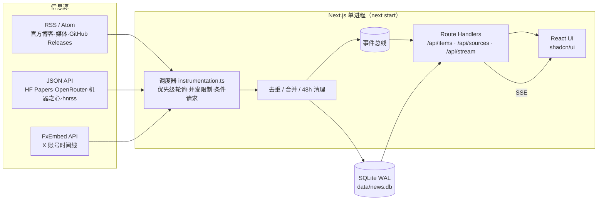

# AI News Radar · AI 新闻雷达

[](LICENSE)
[](https://nextjs.org)
[](https://github.com/iferrnil/ai-news-radar/pkgs/container/ai-news-radar)

> A self-hosted, near-real-time radar for domestic + international AI news: 50 curated sources (lab blogs, API changelogs, X accounts, Chinese media, dev tooling), polled by priority and pushed live to the browser.

为 AI 内容创作者打造的**自托管实时 AI 资讯聚合器**：精选 50 个国内外信息源（官方实验室博客与 API 发布说明、X 账号、中文媒体、开发工具、科技媒体），按优先级轮询，通过 SSE 实时推送到网页。只保留 48 小时内的内容，单进程 + SQLite，几百 MB 内存即可运行。

仓库：<https://github.com/iferrnil/ai-news-radar>

## 功能

- **50 个精选源**：RSS/Atom、JSON API（HF Daily Papers、OpenRouter 新模型、机器之心、hnrss）、GitHub Releases、X 账号（经 FxEmbed，无需 X API Token）
- **优先级轮询**：P0 X 2 分钟 / 网站 5 分钟，P1 5/10 分钟，P2 30 分钟；条件请求（ETag / If-Modified-Since）节省带宽
- **实时推送**：SSE，新内容出现“N 条新内容”提示
- **去重与合并**：按规范化 URL / 推文 ID 去重；推文链接到已有文章时合并为“也在 X”
- **互斥分区**：实验室 / 国内 / 开发 / 媒体 / X 快讯，每条内容只属于一个分区
- **界面**：shadcn/ui 卡片网格、深浅色主题、⌘K 命令面板、J/K 键盘导航、已读变暗、移动端适配
- **数据源管理**：启用/停用、调整间隔、立即抓取、按 URL / @用户名 / X 列表添加并预览
- **站内文档**：`/docs/rate-limits` 列出各类源的官方限额与当前负载

## 截图

| 深色 | 浅色 |
|---|---|
|  |  |
|  |  |
|  |  |

## 架构



## 信息源

当前启用 50 个源，完整目录（含停用参考源）与核验记录见 [docs/sources.md](docs/sources.md)；各类源的官方限额、实测与我们的请求量见 [docs/rate-limits.md](docs/rate-limits.md)（站内 `/docs/rate-limits`）。选源思路见 [docs/recommendations.md](docs/recommendations.md)。

## 快速开始

### Docker Compose（推荐）

```bash
git clone https://github.com/iferrnil/ai-news-radar.git && cd ai-news-radar
docker compose up -d          # 首次会本地构建镜像
open http://localhost:3000    # 数据保存在 ./data
```

### 本地 Node（需 Node ≥ 22）

```bash
npm ci
npm run build && npm run start -- -p 3000
# 开发：npm run dev
```

> 同一个数据目录只能运行**一个**实例（轮询器在服务进程内）。

## 配置（环境变量）

| 变量 | 默认 | 说明 |
|---|---|---|
| `PORT` | 3000 | 服务端口 |
| `NEWS_DB` | `./data/news.db` | SQLite 路径 |
| `SOURCES_JSON` | `./sources/sources.json` | 源目录（启动时同步） |
| `RETENTION_HOURS` | 48 | 内容保留时长 |
| `SEEN_DAYS` | 30 | 已见 ID 保留天数（防止旧内容重复出现） |
| `P0_X` / `P0_FEED` | 120 / 300 | P0 轮询间隔（秒） |
| `P1_X` / `P1_FEED` | 300 / 600 | P1 轮询间隔 |
| `P2_X` / `P2_FEED` | 1800 / 1800 | P2 轮询间隔 |
| `X_CONCURRENCY` / `FEED_CONCURRENCY` | 3 / 8 | 并发上限 |
| `DISABLE_POLLER` | 0 | 设为 1 只提供网页、不抓取 |
| `SYNC_SEED` | 1 | 设为 0 不再用 sources.json 覆盖内置源设置 |
| `HOST_PORT` / `DATA_DIR` | 3000 / `./data` | 仅 docker compose：宿主机端口与数据目录 |

## 添加信息源

- **网页上**：数据源 → 添加数据源，输入网站 URL（自动发现 RSS）、`@用户名` 或 X 列表 URL，预览后添加。
- **内置目录**：编辑 `sources/sources.json`（`type`、`url`、`priority`、`group`），重启后同步。
- **新的源类型**：见 [AGENTS.md](AGENTS.md)「Adding a new source type」。只接受有 RSS/Atom 或 JSON API 的源，不做 HTML 爬取。

## 数据保留与资源

- 只保留 48 小时内容；每 10 分钟清理，并通过 `incremental_vacuum` + WAL `TRUNCATE` 真正回收磁盘空间。数据库通常 < 1 MB。
- 常驻内存约 170 MB（Node + Next.js），CPU 空闲时接近 0，总请求量约 11 次/分钟。

## 部署提示（Oracle Cloud ARM 等）

镜像支持 arm64。在 Ampere A1 上直接 `docker compose up -d` 即可；如用 Node 直接运行，需 Node 22 与编译工具（`build-essential python3`）以构建 better-sqlite3。建议用 systemd 或 compose 的 `restart: unless-stopped` 保活，前面加 Caddy/Nginx 做 HTTPS（SSE 需关闭代理缓冲）。

## 限制与免责声明

- X 内容通过第三方 **FxEmbed**（api.fxtwitter.com）获取，X 列表使用**未公开**的 syndication 接口；二者都不是 X 官方 API，可能随时变更、限流或失效，偶尔出现“假 404”。
- 各站点 feed 的可用性与限额以其自身为准，请遵守各来源的服务条款，保持合理轮询频率（见 rate-limits 文档）。
- 本项目仅聚合标题、摘要与链接，版权归原作者与原站点所有。

## License

[MIT](LICENSE) © 2026 lang li
