# AI News Radar · AI 新闻雷达

[](LICENSE)
[](https://nextjs.org)
[](#镜像加速构建说明)

> A self-hosted, near-real-time radar for domestic + international AI news: 22 curated sources (P0 lab blogs & API notes, scoop X accounts, Chinese AI media, Techmeme, plus a few Chinese entertainment/funny feeds), polled by priority and pushed live to the browser.

为 AI 内容创作者打造的**自托管实时 AI 资讯聚合器**：精选 22 个信息源：只保留最快的 P0 AI 源（官方博客与 API 发布说明、爆料 X 账号、国内 AI 媒体、Techmeme），外加少量国内娱乐/搞笑源，按优先级轮询，通过 SSE 实时推送到网页。只保留 48 小时内的内容，单进程 + SQLite，几百 MB 内存即可运行。

## 功能

- **22 个精选源（精简版）**：RSS/Atom、JSON API（机器之心、网易娱乐、抖音热搜、B 站热门、煎蛋无聊图）、X 账号（经 FxEmbed，无需 X API Token）
- **优先级轮询**：P0 X 2 分钟 / 网站 5 分钟，P1 5/10 分钟，P2 30 分钟；条件请求（ETag / If-Modified-Since）节省带宽
- **实时推送**：SSE，新内容出现“N 条新内容”提示
- **去重与合并**：按规范化 URL / 推文 ID 去重；推文链接到已有文章时合并为“也在 X”
- **仅 P0 按分区记忆**：每个分区/来源各自记住「仅 P0」开关
- **图片缩略图**：带图的条目（梗图、视频封面）在卡片上显示缩略图
- **中文翻译（可选）**：配置 DeepSeek Key 后自动翻译外文标题与摘要，可一键切换原文/译文
- **互斥分区**：实验室 / 国内媒体 / 国外媒体 / X 快讯 / 娱乐，每个来源只属于一个分区（娱乐类 X 账号归「娱乐」）；「娱乐」不计入「全部」，只在自己的分区显示
- **悬停预览**：鼠标停留在卡片上显示 Hover Card（全文、时间、原文链接），触屏设备自动关闭
- **界面**：shadcn/ui 卡片网格、深浅色主题、⌘K 命令面板、J/K 键盘导航、已读变暗、移动端适配
- **数据源管理**：启用/停用、调整间隔、立即抓取、按 URL / @用户名 / X 列表添加并预览
- **导入 / 导出订阅**：JSON（完整设置，可再导入）与 OPML 2.0（兼容其他阅读器），导入前预览新增 / 已存在 / 无效
- **站内文档**：`/docs/rate-limits` 列出各类源的官方限额与当前负载

## 截图

| 深色 | 浅色 |
|---|---|
| 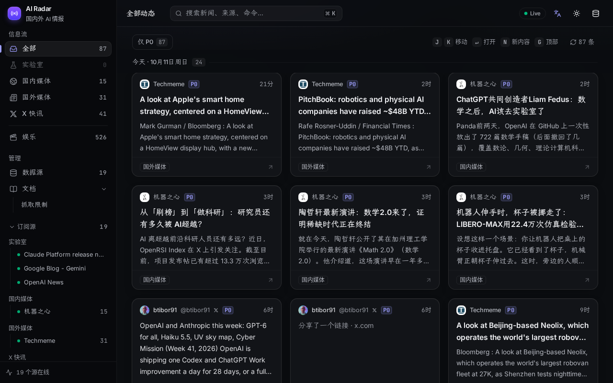 | 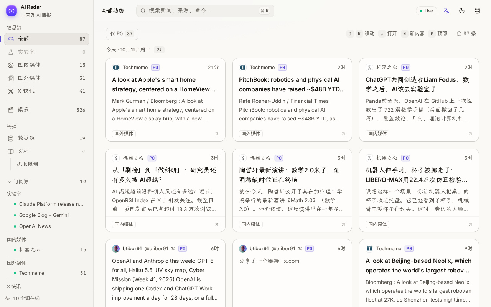 |
| 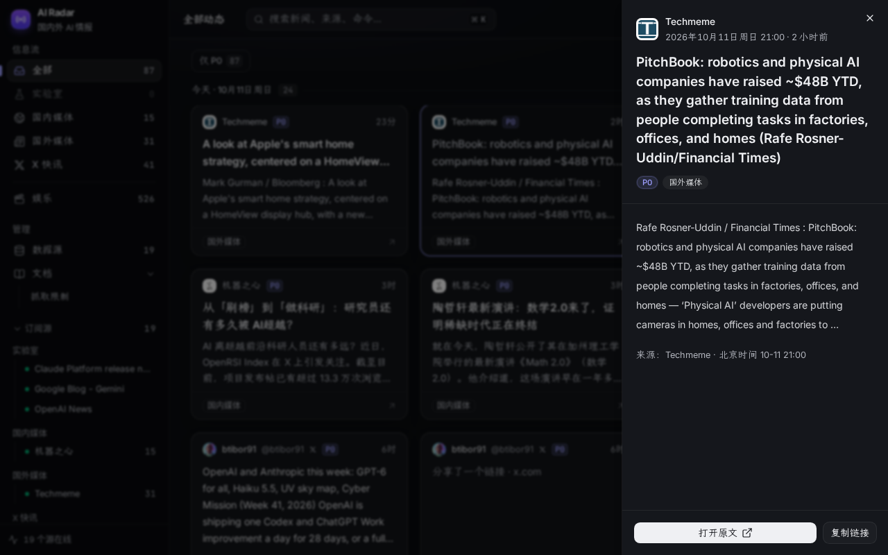 | 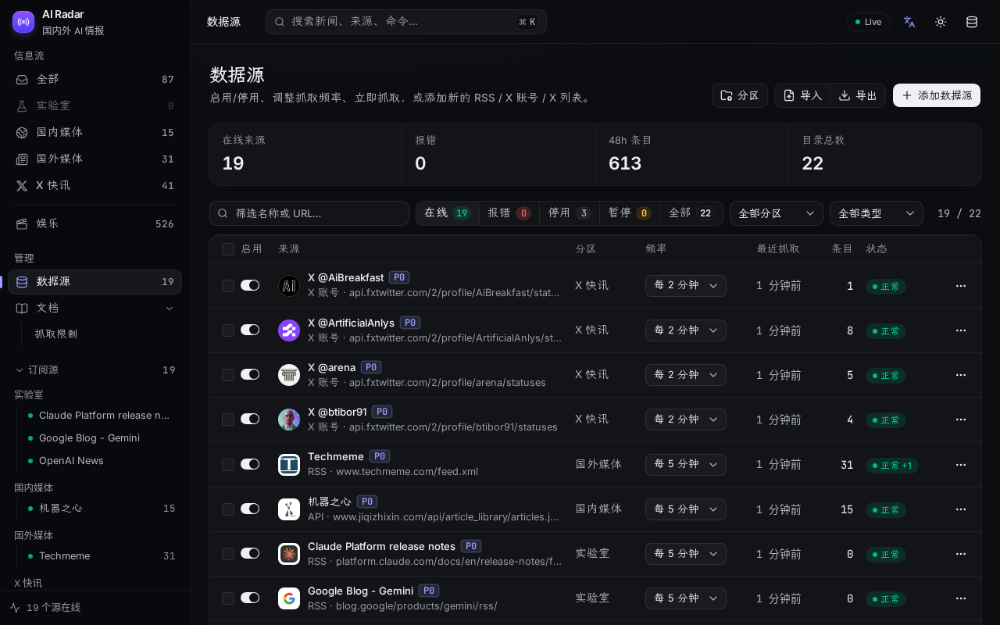 |
| 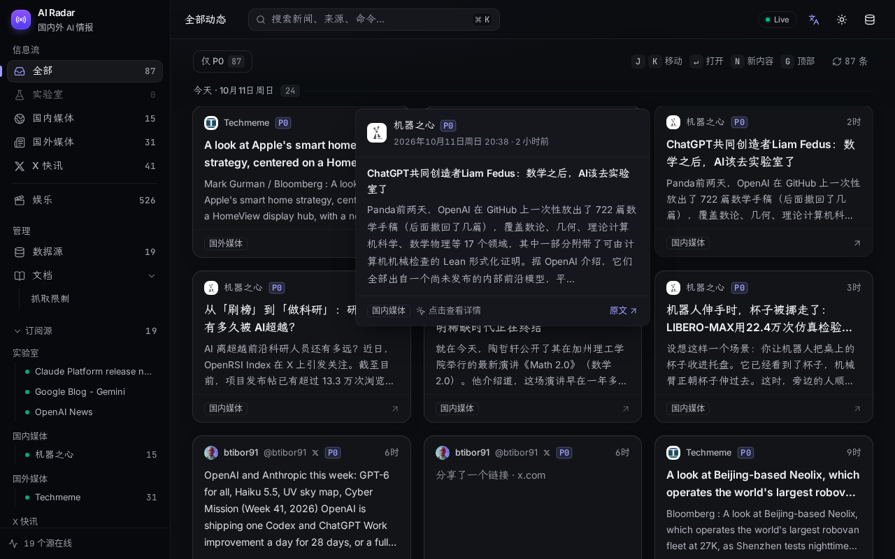 | 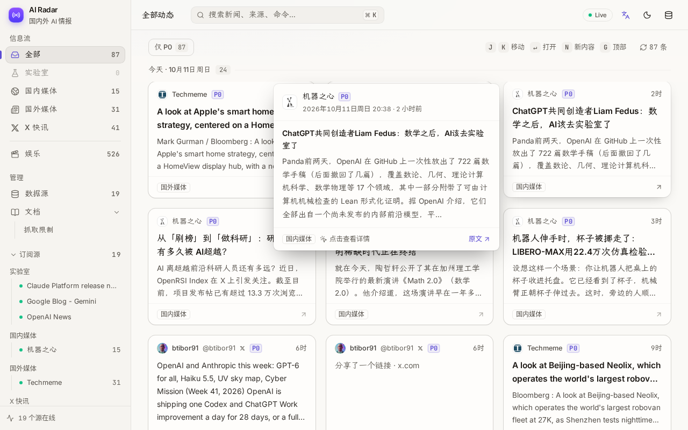 |
| 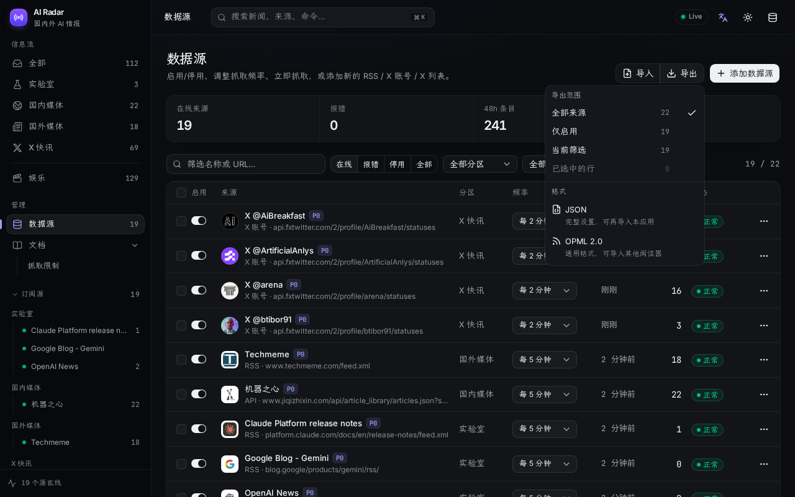 | 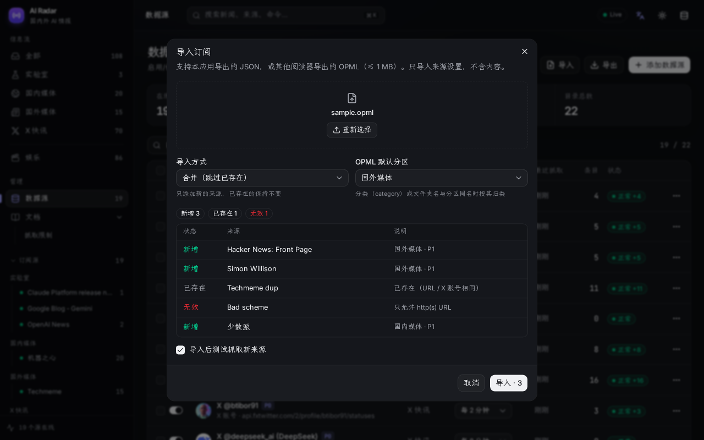 |
| 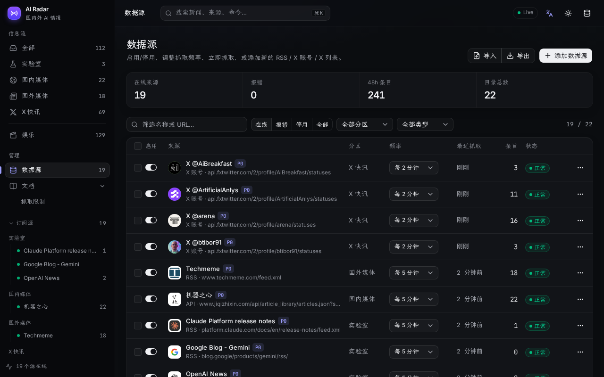 | 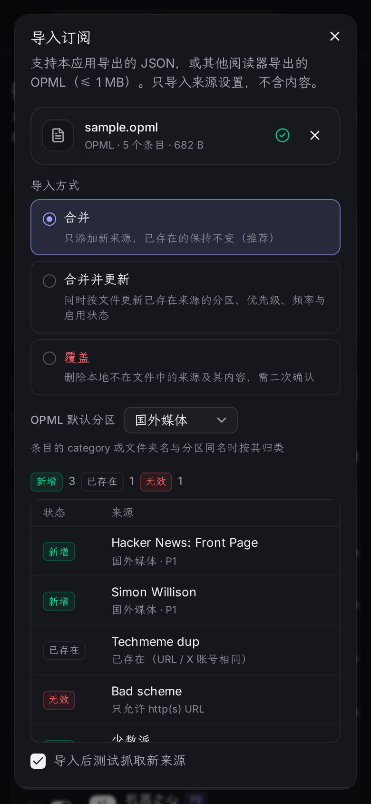 |
| 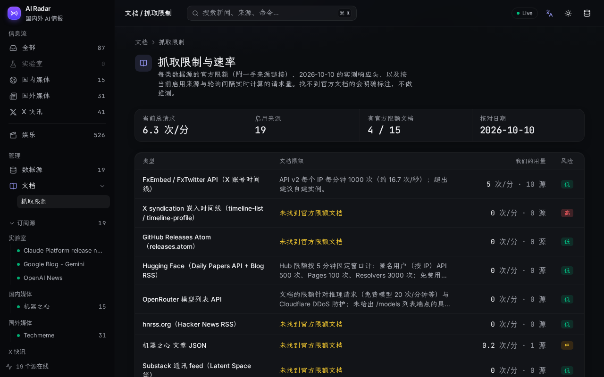 | 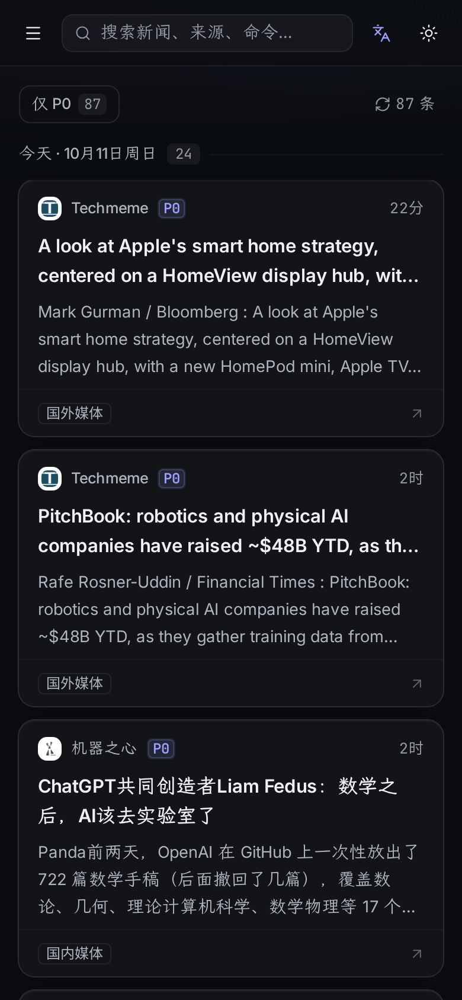 |

## 架构

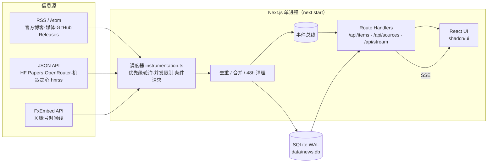

## 中文翻译（DeepSeek，可选）

- 设置 `DEEPSEEK_API_KEY`（见 `.env.example`；本地放 `.env.local`，Docker 用环境变量；切勿提交）后，新抓到的**非中文**条目会在入库后异步翻译**标题和摘要**（中文为主的条目直接跳过）。
- 省钱设计：每批 10 条 JSON 进出、并发 2、超时 90 s、429/5xx 指数退避重试；按内容哈希缓存（重复内容不再翻译），每条只翻译一次；摘要最多 1500 字。原文与译文分开存（`title_zh` / `summary_zh`）。
- 顶栏「文 A」按钮：**翻译成中文**（浏览器端显示开关，译文标「译」，悬停卡片和详情中可看原文）；**抓取时翻译**（服务端开关，存数据库，可覆盖 `TRANSLATE_ENABLED`）。关闭显示时列表接口不返回译文字段。
- 实测：3 条标题+摘要约 290 token；按 DeepSeek flash 价目，翻译 500 条约 $0.1–0.3。

## 信息源

默认 22 个源：实验室 4、国内媒体 2、国外媒体 1（Techmeme）、X 快讯 11（均为 P0），娱乐 4（网易娱乐、抖音热搜、B站热门、煎蛋无聊图，带图片缩略图）；其余来源已从默认列表删除，需要时在站内添加。完整目录（含停用参考源）与核验记录见 [docs/sources.md](docs/sources.md)；各类源的官方限额、实测与我们的请求量见 [docs/rate-limits.md](docs/rate-limits.md)（站内 `/docs/rate-limits`）。选源思路见 [docs/recommendations.md](docs/recommendations.md)。

## 快速开始

### Docker Compose（推荐）

```bash
git clone https://github.com/iferrnil/ai-news-radar.git && cd ai-news-radar
docker compose up -d          # 首次会本地构建镜像
open http://localhost:3080    # 数据保存在 ./data（容器内仍监听 3000）
```

### 本地 Node（需 Node ≥ 22）

```bash
npm ci
npm run build && npm run start -- -p 3000
# 开发：npm run dev
```

> 同一个数据目录只能运行**一个**实例（轮询器在服务进程内）。

## 配置（环境变量）

| 变量 | 默认 | 说明 |
|---|---|---|
| `DEEPSEEK_API_KEY` | （空） | 可选。设置后在抓取时用 DeepSeek 把外文标题/摘要译成中文；不设置则翻译功能自动关闭 |
| `TRANSLATE_ENABLED` | `1` | 抓取时翻译的服务端默认值（站内开关保存在数据库，优先级更高） |
| `DEEPSEEK_MODEL` / `TRANSLATE_BATCH` / `TRANSLATE_CONCURRENCY` / `TRANSLATE_SUMMARY_CHARS` | `deepseek-chat` / `10` / `2` / `1500` | 模型、每批条数、并发、摘要截断长度 |
| `PORT` | 3000 | 服务端口 |
| `NEWS_DB` | `./data/news.db` | SQLite 路径 |
| `SOURCES_JSON` | `./sources/sources.json` | 源目录（启动时同步） |
| `RETENTION_HOURS` | 48 | 内容保留时长 |
| `SEEN_DAYS` | 30 | 已见 ID 保留天数（防止旧内容重复出现） |
| `P0_X` / `P0_FEED` | 120 / 300 | P0 轮询间隔（秒） |
| `P1_X` / `P1_FEED` | 300 / 600 | P1 轮询间隔 |
| `P2_X` / `P2_FEED` | 1800 / 1800 | P2 轮询间隔 |
| `X_CONCURRENCY` / `FEED_CONCURRENCY` | 3 / 8 | 并发上限 |
| `DISABLE_POLLER` | 0 | 设为 1 只提供网页、不抓取 |
| `SYNC_SEED` | 1 | 设为 0 不再用 sources.json 覆盖内置源设置 |
| `HOST_PORT` / `DATA_DIR` | 3080 / `./data` | 仅 docker compose：宿主机端口与数据目录 |

## 添加信息源

- **网页上**：数据源 → 添加数据源，输入网站 URL（自动发现 RSS）、`@用户名` 或 X 列表 URL，预览后添加。
- **内置目录**：编辑 `sources/sources.json`（`type`、`url`、`priority`、`group`），重启后同步。
- **取消订阅**：首页侧栏「订阅源」里，鼠标悬停某个来源（触屏常显）点 ⊖ → 确认即可，提示条里可「撤销」。来源只是停用而非删除，可在「数据源 › 停用」重新启用。
- **删除来源**：「数据源」页每行 ⋯ 菜单 →「删除」，或勾选多行后「删除所选」；会同时删除该来源已保存的内容。内置源删除后会记为墓碑，重启/更新代码也不会再加回来；可在页面右上角「已删除的内置源」中恢复。
- **更新代码（`git pull` / 重新构建镜像）不会覆盖你的选择**：启动时会用 `sources.json` 同步内置源，但只会新增新的内置源、更新 URL/分组；你在界面上改过的启用状态、频率、优先级会记录为用户覆盖，始终以你的设置为准。
- **导出**：「数据源」页右上角「导出」→ 选范围（全部 / 仅启用 / 当前筛选 / 已选中）→ JSON 或 OPML。文件名形如 `ai-news-radar-sources-20261011-0030.json`，只含来源设置（名称、类型、URL 或 X 用户名、分区、优先级、频率、启用状态、主页），不含内容和任何密钥。OPML 中 RSS/Atom 是标准 `type="rss"` 条目（按分区分文件夹）；X 账号/列表以自定义 `type="x"` / `type="x_list"` 写入，其他阅读器会忽略，本应用可再导入。
- **导入**：「导入」→ 拖放或选择文件（≤ 1 MB；本应用 JSON 或任意阅读器的 OPML）→ 预览每一行是 新增 / 已存在（按规范化 URL 或 X 用户名匹配）/ 无效。三种方式：**合并（跳过已存在）**（默认）、**合并并更新已存在的设置**、**覆盖**（删除本地不在文件中的源及其内容，需二次确认）。OPML 的分区按条目 `category` 或所在文件夹名匹配分区名，否则用所选默认分区（默认「国外媒体」）。可勾选「导入后测试抓取新来源」。导入的设置记为用户覆盖，重启/更新不会被还原；文件里有已删除的内置源时会自动恢复。只接受 http(s) URL。
- **新的源类型**：见 [AGENTS.md](AGENTS.md)「Adding a new source type」。只接受有 RSS/Atom 或 JSON API 的源，不做 HTML 爬取。

## 自建分区与过滤规则

- **自建分区**：添加/编辑数据源时，在「分区」下拉选「＋ 新建分区…」，填名称（如「视频生成」「UI设计」）、可选 emoji 图标、是否显示在「全部」（默认是）。侧栏会显示新分区及计数，支持单独的「仅 P0」。在「数据源」页点「分区」（或侧栏分区行上的 ⚙）可重命名、改图标、切换是否计入「全部」、删除（分区仍有来源时需选择要移入的分区）。
- **过滤规则**：在添加对话框展开「过滤规则」，或在数据源行菜单选「编辑分区与过滤…」，填「只保留匹配（包含）」和/或「隐藏匹配（排除）」正则（JavaScript 语法，默认忽略大小写，可选同时匹配摘要）。例：Smol AI News（`https://news.smol.ai/rss.xml`）排除 `not much happened`，或包含 `^((?!not much).)*$`。对话框里实时预览哪些最近条目会被保留/隐藏；服务端会拒绝无效或可能导致回溯爆炸的正则。规则在抓取时生效（被过滤的条目不保存），修改规则会立即隐藏/恢复已抓取的内容。有规则的来源在列表中显示「过滤」标记。
- 导入/导出（JSON 与 OPML）都包含自建分区和过滤规则；导入时按分区名称匹配或自动创建。

## 数据保留与资源

- 只保留 48 小时内容；每 10 分钟清理，并通过 `incremental_vacuum` + WAL `TRUNCATE` 真正回收磁盘空间。数据库通常 < 1 MB。
- 常驻内存约 170 MB（Node + Next.js），CPU 空闲时接近 0，总请求量约 11 次/分钟。

## 部署提示（Oracle Cloud ARM 等）

镜像支持 arm64。在 Ampere A1 上直接 `docker compose up -d` 即可；如用 Node 直接运行，需 Node 22 与编译工具（`build-essential python3`）以构建 better-sqlite3。建议用 systemd 或 compose 的 `restart: unless-stopped` 保活，前面加 Caddy/Nginx 做 HTTPS（SSE 需关闭代理缓冲）。

## 限制与免责声明

- X 内容通过第三方 **FxEmbed**（api.fxtwitter.com）获取，X 列表使用**未公开**的 syndication 接口；二者都不是 X 官方 API，可能随时变更、限流或失效，偶尔出现“假 404”。
- 各站点 feed 的可用性与限额以其自身为准，请遵守各来源的服务条款，保持合理轮询频率（见 rate-limits 文档）。
- 本项目仅聚合标题、摘要与链接，版权归原作者与原站点所有。

## 字体

界面字体：西文与数字用 **Inter**，中文用 **霞鹜文楷 LXGW WenKai**（Regular + Medium），时间用 **JetBrains Mono**。均为 SIL Open Font License 1.1，可随 MIT 项目再分发；通过 npm 包（`@fontsource-variable/*`、`lxgw-wenkai-webfont`）在构建时打包为 woff2，构建不访问 Google/GitHub。中文按 unicode-range 切片按需加载：首页冷启动约 2.1 MB 字体（41 个分片），之后浏览器缓存命中为 0。

## License

[MIT](LICENSE) © 2026 Lang

## 镜像加速构建说明

- 不发布预构建镜像：`docker compose` 只在本地构建（`image: ai-news-radar:local` + `pull_policy: build`），不会去 ghcr.io 拉取。
- 字体（Inter（西文/数字）/ 霞鹜文楷 LXGW WenKai（中文）/ JetBrains Mono（时间），均为 OFL-1.1）通过 npm 包 `@fontsource-variable/*` 与 `lxgw-wenkai-webfont` 自托管，`next build` 不访问 Google Fonts；霞鹜文楷按 unicode-range 分片（Regular + Medium 两个字重），浏览器只下载页面用到的字。
- 构建只需要 npm 源和 Debian apt 源，网络受限时可用构建参数换成镜像源：

```bash
git pull
NPM_REGISTRY=https://registry.npmmirror.com APT_MIRROR=mirrors.tuna.tsinghua.edu.cn docker compose up -d --build
# 或写入 .env：NPM_REGISTRY=...  APT_MIRROR=...
```

- 基础镜像 `node:22-bookworm-slim` 来自 Docker Hub；若拉不下来，请在 Docker/OrbStack 设置里配置 registry mirror。
