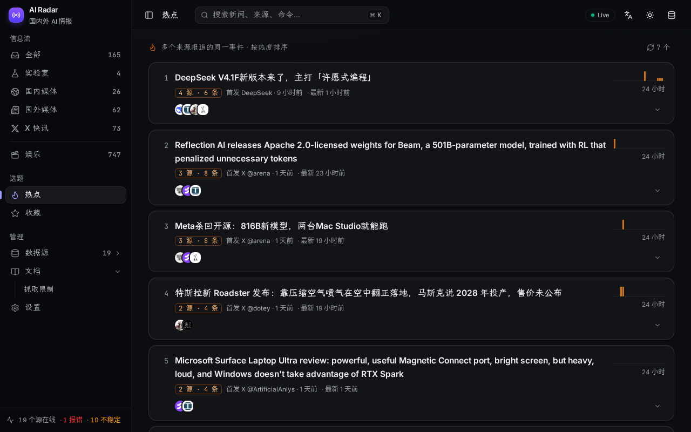
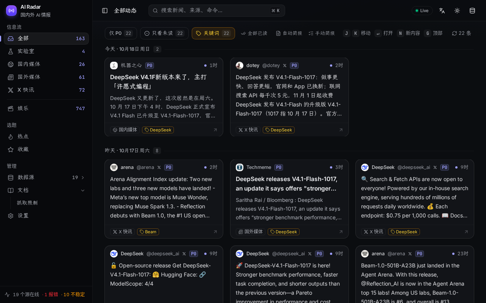
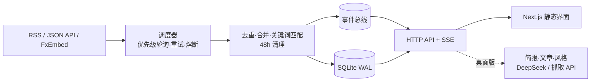

<div align="center">

# AI News Radar · AI 新闻雷达

**自托管、近实时的 AI 资讯雷达**：精选信息源按优先级轮询，SSE 实时推送，热点聚合、关键词标签与筛选；macOS 桌面版另有 AI 简报与一键写稿。

[](https://github.com/iferrnil/ai-news-radar/actions/workflows/ci.yml)
[](https://github.com/iferrnil/ai-news-radar/releases/latest)
[](LICENSE)

[下载](#下载) · [部署](#网页版部署) · [配置](#配置) · [Skill](#文章-skill) · [贡献](CONTRIBUTING.md) · [更新日志](CHANGELOG.md) · [English](#english)


</div>

为 AI 内容创作者打造：只收最快的源（官方博客与发布说明、爆料 X 账号、国内 AI 媒体、Techmeme、GitHub 热门仓库榜），外加少量娱乐源；只保留 48 小时，单个 Go 进程 + SQLite。

## 功能

网页版与桌面版共有：

- **信息流**：24 个内置源（RSS/Atom、JSON API、X 账号经 FxEmbed，无需 X API；含 Trendshift GitHub 日榜 / 周榜），P0 每 2–5 分钟轮询，条件请求；新内容经 SSE 实时出现
- **热点**：多个来源报道的同一事件合并为一个热点，显示来源数、首发来源与时间、24 小时报道量走势，按热度排序；可展开查看每条报道。纯规则计算，不调用模型（规则见下文「热点规则」）
- **关键词**：在设置里添加关注词（如 GPT-6、DeepSeek），可选只匹配标题、区分大小写；命中的条目带关键词标签，点标签或工具栏的「关键词」只看命中的内容
- **收藏**：卡片或详情里加星，侧栏「收藏」集中查看；收藏的条目不受 48 小时清理，随订阅 JSON 一起导出 / 导入
- **通知**：P0 新动态按批合并推送；桌面版为系统通知，网页版可选浏览器通知
- **阅读**：已读 / 未读、只看未读、悬停预览、⌘K 命令面板、J/K 键盘导航、深浅色、移动端
- **数据源管理**：添加（网站 URL 自动发现 RSS、@用户名、X 列表、trendshift.io）、自定义分区（300 多个图标，含 GitHub 等品牌标志）、正则过滤规则、健康度与熔断；JSON / OPML 导入导出
- **翻译（可选）**：配置 DeepSeek key 后翻译外文标题与摘要

仅桌面版（AI 功能）：

- **简报**：自动 / 手动（最多 10 条），先取原文全文再核对事实；可换用自己的 Skill
- **生成文章**：选 1–2 条（或从热点、收藏里选），按推特串推 / 公众号 / 小红书 Skill 写成稿件；程序检查标题字数、禁用词和链接，问题显示在文章上方
- **写作风格**：每个平台导入几篇自己的旧文（粘贴、.md / .txt 或网址），提炼成可编辑的风格档案，写稿时模仿语气，不搬运样本里的事实
- **抓取 API**：Jina Reader / Firecrawl / crawl4ai，自抓失败时依次补抓原文，显示剩余额度
- 原生窗口、菜单栏图标、自动更新（签名校验，支持增量包）

## 截图

| 信息流 | 热点 |
|---|---|
|  |  |
|  |  |
|  |  |
|  |  |

## 下载

**macOS 桌面版**：[GitHub Releases](https://github.com/iferrnil/ai-news-radar/releases/latest)。Apple 芯片选 `…-macos-arm64.dmg`，Intel 选 `…-macos-x64.dmg`，可用 `SHA256SUMS` 校验。

> **首次打开**：未公证的版本会提示“无法验证开发者”。右键 App → **打开** → 再点 **打开**；或执行 `xattr -dr com.apple.quarantine "/Applications/AI News Radar.app"`。

App 每 12 小时检查一次更新（菜单「检查更新…」可手动检查）。数据在 `~/Library/Application Support/AI News Radar/`。

### 自己构建桌面版

需要 Xcode 命令行工具、Node 22（只用于构建界面）和 Go（版本见 `desktop/go.mod`）：

```bash
npm ci
desktop/scripts/package.sh darwin/arm64      # 产物在 desktop/build/
```

桌面版用 [MyGo](https://github.com/egoist/mygo) 做原生外壳，Go 后端在 App 进程内运行，界面嵌入二进制。签名、公证与发布见 [desktop/README.md](desktop/README.md)。

## 网页版部署

不发布预构建镜像，在本地构建：

```bash
git clone https://github.com/iferrnil/ai-news-radar.git && cd ai-news-radar
docker compose up -d          # 打开 http://localhost:3080，数据在 ./data
```

- 可在 amd64 / arm64 上构建运行；compose 默认 `SETTINGS_LOCKED=1`（公网部署请保持）。前面可加 Caddy / Nginx 做 HTTPS，SSE 需关闭代理缓冲。
- 网络受限时用构建参数换源：`NPM_REGISTRY=https://registry.npmmirror.com GOPROXY=https://goproxy.cn,direct APK_MIRROR=mirrors.tuna.tsinghua.edu.cn docker compose up -d --build`。基础镜像来自 Docker Hub，拉不下来时请在 Docker 设置里配置 registry mirror。
- 不用 Docker：

```bash
npm ci && npm run build                                   # 静态界面 → out/
(cd server && go build -o bin/radar-server ./cmd/radar-server)
server/bin/radar-server -ui out                           # http://localhost:3000
```

同一个数据目录只能运行**一个**实例（轮询器在服务进程内）。

## 配置

环境变量（都可选）：

| 变量 | 默认 | 说明 |
|---|---|---|
| `PORT` | `3000` | 服务端口 |
| `NEWS_DB` | `./data/news.db` | SQLite 路径 |
| `SOURCES_JSON` | `./sources/sources.json` | 内置源目录（启动时同步，不覆盖你在界面上的修改；`SYNC_SEED=0` 关闭同步） |
| `RETENTION_HOURS` / `SEEN_DAYS` | `48` / `30` | 内容保留时长 / 已见 ID 保留天数（收藏不受清理） |
| `SETTINGS_LOCKED` | 本地 `0`，Docker `1` | `1` = 锁定站内密钥类设置（不能在网页里保存 / 测试 key，不能导入收藏，不能改热点词表）；关键词、收藏、翻译开关仍可用 |
| `DEEPSEEK_API_KEY` | 空 | 翻译用；也可在「设置」里填写（存于数据目录 `secrets.json`，0600） |
| `DEEPSEEK_BASE_URL` / `DEEPSEEK_MODEL` | `https://api.deepseek.com` / `deepseek-chat` | 兼容 OpenAI 接口的模型服务 |
| `TRANSLATE_BATCH` / `TRANSLATE_CONCURRENCY` / `TRANSLATE_SUMMARY_CHARS` | `10` / `2` / `1500` | 翻译批大小、并发、摘要截断 |
| `P0_X` / `P0_FEED`，`P1_X` / `P1_FEED`，`P2_X` / `P2_FEED` | `120/300`，`300/600`，`1800/1800` | 各优先级轮询间隔（秒） |
| `X_CONCURRENCY` / `FEED_CONCURRENCY` | `3` / `8` | 并发上限 |
| `FX_MIRRORS` / `FX_TIMEOUT_MS` / `FX_TRIES` | `https://api.fxtwitter.com/2` / `12000` / `3` | FxEmbed 镜像（逗号分隔，依次故障转移）、超时、重试 |
| `BREAK_AFTER` | `5` | 连续失败多少次后熔断 |
| `NOTIFY_BATCH_MS` / `NOTIFY_MIN_GAP_MS` / `NOTIFY_MAX_AGE` | `20000` / `60000` / `10800` | P0 通知合并窗口、最小间隔（毫秒）、只通知多少秒内的内容 |
| `DISABLE_POLLER` | `0` | `1` = 只提供网页、不抓取 |
| `ALLOWED_HOSTS` | 空 | 逗号分隔的域名（可带端口）；设置后只接受这些 Host 的请求，其余返回 421（防 DNS 重绑定） |
| `ALLOW_PRIVATE_FETCH` | `0` | `1` = 允许服务端抓取本机 / 内网地址（默认拒绝，防 SSRF） |
| `HOST_PORT` / `DATA_DIR` | `3080` / `./data` | 仅 docker compose |

站内「设置」页：

- **通知**：P0 通知开关与分区；网页版需授权浏览器通知（页面在前台时只显示站内提示）。
- **关键词**：关注词列表、只匹配标题、区分大小写。修改后立即重新匹配已有内容；信息流按 `?kw=` 筛选（`*` = 任一关键词）。
- **热点词表**：补充热点用的产品 / 公司名，每行一个，别名用 `=` 连接（如 `元宝=Yuanbao=腾讯元宝`）；设置锁定时不显示。
- **DeepSeek**：key、Base URL、模型，带测试连接；任何接口和日志都只显示“已配置”。
- **抓取 API**（桌面版）：Jina Reader（Base URL 可改，国内可用 `https://r.jinaai.cn`）、Firecrawl、crawl4ai 三个 key，掩码保存；按 Jina → Firecrawl → crawl4ai 顺序补抓，额度用尽或限流时自动换下一个。
- **多模态模型**（桌面版，可选）：OpenAI 兼容接口，图片模型为公众号 / 小红书文章生成封面，看图模型读取原文配图。0.14.0 起不再支持视频任务接口，旧设置里的视频字段会被忽略。

### 工作目录（桌面版）

默认 `~/Documents/AI News Radar`，可在设置里修改。简报和文章只在点「导出」时写入：

```
工作目录/
├── 简报/2026-10-17/223015-标题.md
├── 文章/2026-10-17/223310-标题.md（封面图在旁边）
└── 缓存/            # 原文全文与生成的封面，24 小时后清理
```

## 热点规则

热点完全由程序规则计算（`server/radar/hot.go`、`hotlex.go`），不调用模型、不消耗 token：

- **名称**：从标题和摘要开头提取产品 / 模型 / 公司名（大写、带数字或版本号的词）。中文用内置词表按最长匹配识别（豆包、可灵、通义千问、文心、元宝、混元、智谱、月之暗面、字节跳动、阿里、腾讯、百度、华为、商汤、MiniMax / 海螺、阶跃、零一万物等），并与英文名对应：字节跳动 = ByteDance，通义千问 / 千问 = Qwen，月之暗面 = Moonshot / Kimi，智谱 = Zhipu / GLM，文心 = ERNIE，可灵 = Kling。版本写法统一：GPT-6、GPT 6、gpt6 是同一个名字。设置里的「热点词表」可以补充。
- **主体**：两条内容只有在共同名称是双方的主体时才合并：出现在两边的标题里，或在一边的标题里、另一边的开头重复出现。比较对象不算（「超过 GPT-6」「beats Claude」之后的名称）。
- **不串联**：同一热点里的每条报道都要提到同一个核心名称，且至少一半以它为主体，A 像 B、B 像 C 不会把 A 和 C 拉进同一个热点；只共享核心名称的同一事件片段会重新合并。
- **热度**：官方 / 第一方来源 1.5，文章 1，X 转述账号 0.7，非 P0 来源再 ×0.6；同一来源的后续报道 ×0.3；12 小时半衰。最近 1 小时的报道另外加分，集中爆发的事件显示「飙升」。
- **首发**：每个热点的首发报道（来源、时间、标题、链接）另存 7 天，条目被 48 小时清理后仍能看到最早的报道者。

## 文章 Skill

简报和三种文章各用一个 Skill，格式为 [Agent Skills](https://agentskills.io)：一个文件夹，`SKILL.md` 以 YAML 头开始（`name`、`description`、可选 `version`），正文是写作指令，可带 `references/`、`assets/`、`scripts/`（脚本只作参考，不会执行）。

```
wechat-article/
├── SKILL.md
├── references/   # 去 AI 腔清单、平台规则
├── assets/       # 格式骨架
└── scripts/      # 检查脚本（不执行）
```

- 内置：`brief-polish`、`twitter-article`、`wechat-article`、`xhs-article`（源码在 `server/radar/defaultskill/`）。
- 替换：设置 › 对应平台的 Skill 卡片 → 填 GitHub 目录 / .zip / .tar.gz / SKILL.md 的网址安装，或上传文件；可随时切回内置。安装的 Skill 保存在数据目录 `skills/<name>/`。
- 写作风格档案与样本按平台分开保存，和 Skill 一起交给模型；样本只用于模仿语气。

## 架构



- `server/`：纯 Go 单二进制（modernc SQLite，无 cgo），同时提供 `/api/*` 与静态界面。
- `src/`：Next.js 16 静态导出 + shadcn/ui（Base UI）+ Tailwind v4。
- `desktop/`：MyGo 外壳，进程内运行同一套后端（只监听 127.0.0.1），原生通知与剪贴板。
- AI、Skill、写作风格、抓取 API 的接口只在桌面版开放，网页版返回 404。

## 数据源

默认 24 个源：实验室 4、国内媒体 2、国外媒体 3（Techmeme、Trendshift 日榜 / 周榜）、X 快讯 11、娱乐 4。目录与核验见 [docs/sources.md](docs/sources.md)，各源限额与本项目请求量见 [docs/rate-limits.md](docs/rate-limits.md)。

- 在「数据源」页添加、停用、删除、改分区和过滤规则；改动记为用户覆盖，更新代码不会还原。
- 只接入有 RSS/Atom 或 JSON API 的源，不做 HTML 爬取；新增源类型见 [AGENTS.md](AGENTS.md)。唯一例外是 Trendshift：它没有免费 API，数据优先取第三方项目 [quantavil/trendshift](https://github.com/quantavil/trendshift) 每天同步到 GitHub Pages 的静态 JSON，失败时才读 trendshift.io 页面里的排行榜结构化数据；两者都失败则保留已有条目。榜单不参与热点。
- 来源图标由服务端代取并缓存（`/api/icon`，只代取已配置来源的站点），页面不直接访问外部图标服务。
- X 内容经第三方 FxEmbed，X 列表用未公开的 syndication 接口，均非官方 API，可能变更或失效。请遵守各来源条款；本项目只聚合标题、摘要与链接，版权归原作者。

## 字体

西文 Inter、中文霞鹜文楷、时间 JetBrains Mono（均为 OFL 1.1），构建时从 npm 包打包，不访问外部字体服务。见 [THIRD_PARTY_FONTS.md](THIRD_PARTY_FONTS.md)。

## 贡献

欢迎 Issue 和 PR，开发与测试见 [CONTRIBUTING.md](CONTRIBUTING.md)；安全问题按 [SECURITY.md](SECURITY.md) 私下报告。

## English

AI News Radar is a self-hosted, near-real-time AI news radar: a single pure-Go server (SQLite) with a static Next.js UI. Curated sources polled by priority, live SSE updates, multi-source hot topics (rule-based, with a Chinese / English name lexicon), keyword tags and filters, favorites, and notifications. The macOS desktop app adds AI briefs and article drafts for X / WeChat / Xiaohongshu in your own writing style. Quick start: `docker compose up -d`, then open http://localhost:3080.

## License

[MIT](LICENSE) © 2026 Lang
