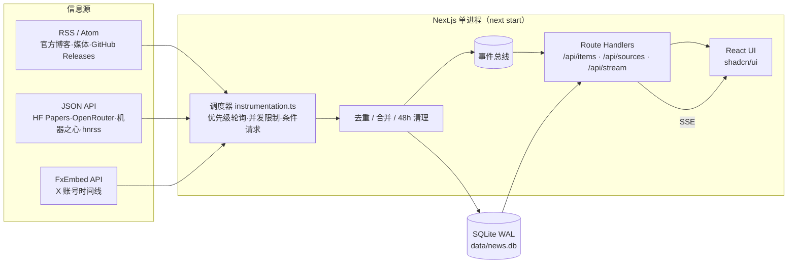

<div align="center">

# AI News Radar · AI 新闻雷达

**自托管、近实时的 AI 资讯雷达**：22 个精选信息源，按优先级轮询，SSE 实时推送，P0 系统通知。

[](https://github.com/iferrnil/ai-news-radar/actions/workflows/ci.yml)
[](https://github.com/iferrnil/ai-news-radar/releases/latest)
[](LICENSE)
[](https://nextjs.org)
[](https://nodejs.org)

[English summary](#english) · [下载](#下载) · [快速开始](#快速开始) · [配置](#配置) · [贡献](CONTRIBUTING.md) · [更新日志](CHANGELOG.md)


</div>

为 AI 内容创作者打造：只保留最快的 P0 AI 源（官方博客与 API 发布说明、爆料 X 账号、国内 AI 媒体、Techmeme），外加少量国内娱乐/搞笑源。只保留 48 小时内容，单进程 + SQLite，几百 MB 内存即可运行；也提供 macOS 桌面版。

## 功能

- **22 个精选源**：RSS/Atom、JSON API（机器之心、网易娱乐、抖音热搜、B 站热门、煎蛋无聊图）、X 账号（经 FxEmbed，无需 X API Token）
- **优先级轮询**：P0 X 2 分钟 / 网站 5 分钟，P1 5/10 分钟，P2 30 分钟；条件请求（ETag / If-Modified-Since）
- **实时推送**：SSE，新内容出现“N 条新内容”提示
- **P0 通知**：新的 P0 动态合并推送（约 20 秒一批、至少间隔 1 分钟），启动积压和旧内容不打扰；桌面版为系统通知（点击直达该条），网页版可选浏览器通知；可按分区选择
- **已读 / 未读**：未读圆点、「只看未读」、按当前视图「全部已读」（可撤销）、侧栏未读数，可选悬停预览即已读
- **抓取可靠性与健康度**：超时、指数退避 + 抖动、区分 FxEmbed 伪 404 与真 404、备用镜像、熔断；「数据源」页「健康」列与侧栏状态点显示近 20 次成功率、延迟和最近错误
- **去重与合并**：按规范化 URL / 推文 ID 去重；推文链接到已有文章时合并为“也在 X”
- **分区与过滤规则**：自定义分区（图标、排序、是否计入「全部」）、按标题正则保留/隐藏，实时预览
- **中文翻译（可选）**：配置 DeepSeek Key 后自动翻译外文标题与摘要，可一键切换原文/译文
- **界面**：shadcn/ui 卡片网格、深浅色主题、⌘K 命令面板、J/K 键盘导航、悬停预览、移动端适配
- **数据源管理**：启用/停用、间隔、立即抓取、按 URL / @用户名 / X 列表添加并预览；JSON 与 OPML 2.0 导入导出
- **macOS 桌面版**：原生窗口与菜单栏图标、系统通知、自动更新

## 截图

| 深色 | 浅色 |
|---|---|
|  |  |
|  |  |
|  |  |
|  |  |
|  |  |
|  |  |

## 下载

**macOS 桌面版**：[GitHub Releases 最新版本](https://github.com/iferrnil/ai-news-radar/releases/latest)。Apple Silicon 选 `…-macos-arm64.dmg`，Intel 选 `…-macos-x64.dmg`，可用 `SHA256SUMS` 校验（`shasum -a 256 -c SHA256SUMS`）。

> **首次打开（Gatekeeper）**：未公证的版本会提示“无法验证开发者”。右键（Control-点按）App → **打开** → 再点 **打开**；或 系统设置 → 隐私与安全性 → **仍要打开**；或执行 `xattr -dr com.apple.quarantine "/Applications/AI News Radar.app"`。

0.2.0 起 App 每 12 小时自动检查更新（菜单「检查更新…」可手动检查），更新包经 ed25519 签名校验后安装；0.1.0 需要手动安装一次 0.2.0。

网页版没有预构建镜像，请按下面的方式自行部署。

## 快速开始

### Docker Compose（推荐）

```bash
git clone https://github.com/iferrnil/ai-news-radar.git && cd ai-news-radar
docker compose up -d          # 首次会本地构建镜像
open http://localhost:3080    # 数据保存在 ./data（容器内仍监听 3000）
```

### 本地开发（Node ≥ 22）

```bash
npm ci
npm run dev                                  # 开发模式 http://localhost:3000
npm run build && npm run start -- -p 3000    # 生产模式
```

> 同一个数据目录只能运行**一个**实例（轮询器在服务进程内）。

### 桌面版（macOS，需 Go 与 Node 22）

```bash
STANDALONE=1 npm run build
desktop/scripts/package.sh darwin/arm64      # 产物在 desktop/build/
```

详见 [desktop/README.md](desktop/README.md)。

## 配置

| 变量 | 默认 | 说明 |
|---|---|---|
| `DEEPSEEK_API_KEY` | （空） | 可选。设置后在抓取时用 DeepSeek 把外文标题/摘要译成中文；不设置则翻译功能自动关闭 |
| `SETTINGS_LOCKED` | 本地 `0`；**Docker 镜像/compose 默认 `1`** | `1` = 锁定站内设置：不能在网页里保存/清除/测试新 key（防止公网访客设置 key），只能用环境变量；私有部署可设 `0` |
| `SECRETS_FILE` | `<NEWS_DB 所在目录>/secrets.json` | 站内保存的 DeepSeek 设置文件（0600） |
| `TRANSLATE_ENABLED` | `1` | 抓取时翻译的服务端默认值（站内开关保存在数据库，优先级更高） |
| `DEEPSEEK_MODEL` / `TRANSLATE_BATCH` / `TRANSLATE_CONCURRENCY` / `TRANSLATE_SUMMARY_CHARS` | `deepseek-chat` / `10` / `2` / `1500` | 模型、每批条数、并发、摘要截断长度 |
| `PORT` | 3000 | 服务端口 |
| `NEWS_DB` | `./data/news.db` | SQLite 路径 |
| `SOURCES_JSON` | `./sources/sources.json` | 源目录（启动时同步） |
| `RETENTION_HOURS` | 48 | 内容保留时长 |
| `SEEN_DAYS` | 30 | 已见 ID 保留天数（防止旧内容重复出现） |
| `P0_X` / `P0_FEED` | 120 / 300 | P0 轮询间隔（秒） |
| `P1_X` / `P1_FEED` | 300 / 600 | P1 轮询间隔 |
| `P2_X` / `P2_FEED` | 1800 / 1800 | P2 轮询间隔 |
| `X_CONCURRENCY` / `FEED_CONCURRENCY` | 3 / 8 | 并发上限 |
| `DISABLE_POLLER` | 0 | 设为 1 只提供网页、不抓取 |
| `SYNC_SEED` | 1 | 设为 0 不再用 sources.json 覆盖内置源设置 |
| `HOST_PORT` / `DATA_DIR` | 3080 / `./data` | 仅 docker compose：宿主机端口与数据目录 |
| `FX_MIRRORS` | `https://api.fxtwitter.com/2` | X 抓取的 FxEmbed 镜像列表（逗号分隔，按顺序故障转移；单个镜像连续 3 次失败后暂停 5 分钟） |
| `FX_TIMEOUT_MS` / `FX_TRIES` | 12000 / 3 | 每次 FxEmbed 请求的超时与重试次数（指数退避 + 抖动，遵守 `Retry-After`） |
| `BREAK_AFTER` | 5 | 来源连续失败多少次后熔断（5 分钟起、最长 1 小时冷却后再试探） |
| `NOTIFY_BATCH_MS` / `NOTIFY_MIN_GAP_MS` / `NOTIFY_MAX_AGE` | 20000 / 60000 / 10800 | P0 通知合并窗口、两次通知最小间隔（毫秒）、只通知多少秒内发布的内容 |
| `READ_SYNC` | 0（桌面版 1） | 1 = 已读状态同时保存到服务器数据库（`/api/read`） |
| `UPSTREAM_MOCK` | （空） | **仅测试 / CI**：所有外部请求改发到本地 mock（`e2e/mock-upstream.mjs`） |

### 中文翻译（DeepSeek，可选）

- 在 **设置** 页（侧栏「设置」或 ⌘K）填写 DeepSeek API key（可选 Base URL / 模型，带“测试连接”），立即生效、无需重启；key 只存服务器端 `data/secrets.json`（权限 0600），任何接口/导出/日志都只显示“已配置”。也可用环境变量 `DEEPSEEK_API_KEY`（见 `.env.example`；本地放 `.env.local`；切勿提交），站内保存的 key 优先。配置后，新抓到的**非中文**条目会在入库后异步翻译**标题和摘要**（中文为主的条目直接跳过）。
- 省钱设计：每批 10 条 JSON 进出、并发 2、超时 90 s、429/5xx 指数退避重试；按内容哈希缓存（重复内容不再翻译），每条只翻译一次；摘要最多 1500 字。原文与译文分开存（`title_zh` / `summary_zh`）。
- 顶栏「文 A」按钮：**翻译成中文**（浏览器端显示开关，译文标「译」，悬停卡片和详情中可看原文）；**抓取时翻译**（服务端开关，存数据库，可覆盖 `TRANSLATE_ENABLED`）。关闭显示时列表接口不返回译文字段。
- 实测：3 条标题+摘要约 290 token；按 DeepSeek flash 价目，翻译 500 条约 $0.1–0.3。

### 通知

「设置 › 通知」：开关「P0 通知」，选择全部分区或指定分区，可「发送测试通知」。网页版需要点「允许浏览器通知」授权；页面在前台时只显示站内提示，在后台时发系统通知。桌面版默认开启，由 App 发系统通知。

## 架构



- **抓取**：`src/lib/fetchers.ts`（RSS/Atom、JSON API、FxEmbed、X 列表）经 `src/lib/net.ts` 统一做超时、重试和退避；每次结果写入 `source_health`，连续失败的来源自动熔断。
- **存储**：SQLite WAL，48 小时滚动清理（`incremental_vacuum` + WAL `TRUNCATE`），数据库通常 < 1 MB；常驻内存约 170 MB。
- **推送**：进程内事件总线 → `/api/stream`（SSE）→ 前端；P0 通知按批次走同一通道。
- **桌面版**：`desktop/`，基于 [MyGo](https://github.com/egoist/mygo)，内置 Node 22 运行同一套 Next.js 服务（仅监听 127.0.0.1）。

## 数据源与频率限制

默认 22 个源：实验室 4、国内媒体 2、国外媒体 1（Techmeme）、X 快讯 11（均为 P0），娱乐 4（带图片缩略图）。完整目录与核验记录见 [docs/sources.md](docs/sources.md)；各类源的官方限额、实测与本项目请求量（总计约 11 次/分钟）见 [docs/rate-limits.md](docs/rate-limits.md)（站内 `/docs/rate-limits`）；选源思路见 [docs/recommendations.md](docs/recommendations.md)。

### 添加信息源

- **网页上**：数据源 → 添加数据源，输入网站 URL（自动发现 RSS）、`@用户名` 或 X 列表 URL，预览后添加。
- **内置目录**：编辑 `sources/sources.json`（`type`、`url`、`priority`、`group`），重启后同步。
- **取消订阅**：首页侧栏「订阅源」里，鼠标悬停某个来源（触屏常显）点 ⊖ → 确认即可，提示条里可「撤销」。来源只是停用而非删除，可在「数据源 › 停用」重新启用。
- **删除来源**：「数据源」页每行 ⋯ 菜单 →「删除」，或勾选多行后「删除所选」；会同时删除该来源已保存的内容。内置源删除后会记为墓碑，重启/更新代码也不会再加回来；可在页面右上角「已删除的内置源」中恢复。
- **更新代码（`git pull` / 重新构建镜像）不会覆盖你的选择**：启动时会用 `sources.json` 同步内置源，但只会新增新的内置源、更新 URL/分组；你在界面上改过的启用状态、频率、优先级会记录为用户覆盖，始终以你的设置为准。
- **导出**：「数据源」页右上角「导出」→ 选范围（全部 / 仅启用 / 当前筛选 / 已选中）→ JSON 或 OPML。文件名形如 `ai-news-radar-sources-20261011-0030.json`，只含来源设置（名称、类型、URL 或 X 用户名、分区、优先级、频率、启用状态、主页），不含内容和任何密钥。OPML 中 RSS/Atom 是标准 `type="rss"` 条目（按分区分文件夹）；X 账号/列表以自定义 `type="x"` / `type="x_list"` 写入，其他阅读器会忽略，本应用可再导入。
- **导入**：「导入」→ 拖放或选择文件（≤ 1 MB；本应用 JSON 或任意阅读器的 OPML）→ 预览每一行是 新增 / 已存在（按规范化 URL 或 X 用户名匹配）/ 无效。三种方式：**合并（跳过已存在）**（默认）、**合并并更新已存在的设置**、**覆盖**（删除本地不在文件中的源及其内容，需二次确认）。OPML 的分区按条目 `category` 或所在文件夹名匹配分区名，否则用所选默认分区（默认「国外媒体」）。可勾选「导入后测试抓取新来源」。导入的设置记为用户覆盖，重启/更新不会被还原；文件里有已删除的内置源时会自动恢复。只接受 http(s) URL。
- **新的源类型**：见 [AGENTS.md](AGENTS.md)「Adding a new source type」。只接受有 RSS/Atom 或 JSON API 的源，不做 HTML 爬取。

### 分区与过滤规则

- **新建分区**：添加/编辑数据源时，在「分区」下拉选「＋ 新建分区…」，填名称（如「视频生成」「UI设计」）、可选 emoji 图标、是否显示在「全部」（默认是）。侧栏会显示新分区及计数，支持单独的「仅 P0」。在「数据源」页点「分区」（或侧栏分区行上的 ⚙）可重命名、改图标、切换是否计入「全部」、删除（分区仍有来源时需选择要移入的分区）。
- **过滤规则**：在添加对话框展开「过滤规则」，或在数据源行菜单选「编辑」，填「只保留匹配（包含）」和/或「隐藏匹配（排除）」正则（JavaScript 语法，默认忽略大小写，可选同时匹配摘要）。例：Smol AI News（`https://news.smol.ai/rss.xml`）排除 `not much happened`，或包含 `^((?!not much).)*$`。对话框里实时预览哪些最近条目会被保留/隐藏；服务端会拒绝无效或可能导致回溯爆炸的正则。规则在抓取时生效（被过滤的条目不保存），修改规则会立即隐藏/恢复已抓取的内容。有规则的来源在列表中显示「过滤」标记。
- 导入/导出（JSON 与 OPML）都包含分区和过滤规则；导入时按分区名称匹配或自动创建。
- **分区图标**：点图标按钮打开选择器，可按分类浏览、搜索（如「视频」「设计」）、使用最近选过的图标，或清除图标。
- **管理分区**：所有分区（包括原来的实验室、国内媒体、国外媒体、X 快讯、娱乐）都可在「数据源 › 分区」或侧栏分区上的 ⚙ 里重命名、换图标、上下移动排序、设置是否计入「全部」或删除；只有「全部」固定。删除时会提示无法撤销、影响多少来源，并提供「先导出备份（JSON）」；有来源的分区需选择要移入的分区。重启或内置源同步不会恢复已删除的分区，也不会改回你的修改；新增的内置源若原分区已被删除，会放进自动创建的「未分类」。
- **重命名来源**：在「数据源」列表点名称直接编辑（回车保存、Esc 取消），或行菜单「重命名」/「编辑」。重命名会保留，重启和内置源同步都不会改回；信息流、侧栏、导出都使用新名称。
- **侧栏数据源**：「管理 › 数据源」和「文档」一样是可折叠分组（点标题只展开/收起），里面每个分区是一个可单独折叠的文件夹，列出该分区的订阅源（点击筛选该来源，悬停可取消订阅）。展开状态会记住。数据源管理页可从顶栏的数据源按钮、命令面板（⌘K →「管理数据源」）或分区行的 ⚙ 进入。

### 限制与免责声明

- X 内容通过第三方 **FxEmbed**（api.fxtwitter.com）获取，X 列表使用**未公开**的 syndication 接口；二者都不是 X 官方 API，可能随时变更、限流或失效。本项目会识别 FxEmbed 的“伪 404”并重试，可用 `FX_MIRRORS` 配置备用镜像。
- 各站点 feed 的可用性与限额以其自身为准，请遵守各来源的服务条款，保持合理轮询频率。
- 本项目仅聚合标题、摘要与链接，版权归原作者与原站点所有。

## 部署提示

镜像支持 arm64（如 Oracle Cloud Ampere A1），直接 `docker compose up -d`；用 Node 直接运行需编译工具（`build-essential python3`）以构建 better-sqlite3。建议 compose `restart: unless-stopped` 保活，前面加 Caddy/Nginx 做 HTTPS（SSE 需关闭代理缓冲）。公网部署请保持 `SETTINGS_LOCKED=1`。

### 构建加速

- 不发布预构建镜像：`docker compose` 只在本地构建（`image: ai-news-radar:local` + `pull_policy: build`），不会去 ghcr.io 拉取。
- 字体（Inter（西文/数字）/ 霞鹜文楷 LXGW WenKai（中文）/ JetBrains Mono（时间），均为 OFL-1.1）通过 npm 包 `@fontsource-variable/*` 与 `lxgw-wenkai-webfont` 自托管，`next build` 不访问 Google Fonts；霞鹜文楷按 unicode-range 分片（Regular + Medium 两个字重），浏览器只下载页面用到的字。
- 构建只需要 npm 源和 Debian apt 源，网络受限时可用构建参数换成镜像源：

```bash
git pull
NPM_REGISTRY=https://registry.npmmirror.com APT_MIRROR=mirrors.tuna.tsinghua.edu.cn docker compose up -d --build
# 或写入 .env：NPM_REGISTRY=...  APT_MIRROR=...
```

- 基础镜像 `node:22-bookworm-slim` 来自 Docker Hub；若拉不下来，请在 Docker/OrbStack 设置里配置 registry mirror。

## 字体

西文与数字 **Inter**，中文 **霞鹜文楷 LXGW WenKai**，时间 **JetBrains Mono**，均为 SIL OFL 1.1，构建时从 npm 包打包为 woff2，不访问外部字体服务。详见 [THIRD_PARTY_FONTS.md](THIRD_PARTY_FONTS.md)。

## 贡献

欢迎 Issue 和 PR！开发环境、测试（`bash e2e/runall.sh`，使用本地 mock 上游，不依赖外网）和提交规范见 [CONTRIBUTING.md](CONTRIBUTING.md)；安全问题请按 [SECURITY.md](SECURITY.md) 私下报告。

## English

AI News Radar is a self-hosted, near-real-time AI news aggregator (Next.js 16 + SQLite, single process): 22 curated sources polled by priority, live SSE updates, P0 notifications, read/unread tracking, per-source health with retries and circuit breaking, optional DeepSeek translation, and a macOS desktop app with auto-update. Quick start: `docker compose up -d`, then open http://localhost:3080.

## License

[MIT](LICENSE) © 2026 Lang
